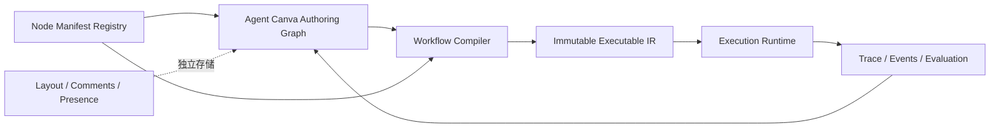

# Agent Canva Next 升级方案

## 1. 升级目标

Agent Canva v1 已证明“可视化编辑 → 校验 → 保存 → 发布 → 运行”闭环成立。Next 的目标不是增加更多孤立按钮，而是把它升级为生产级 AI 应用编排工作台：复杂流程仍然可理解、可测试、可治理、可复用、可稳定发布。

Next 的核心用户路径：

> 从模板或自然语言生成草稿 → 使用带类型端口的节点编排 → 映射变量和异常策略 → 单节点/全流程调试 → 用测试集评估 → 审核差异 → 发布到环境或 API。

## 2. v1 现状与升级瓶颈

| 领域 | v1 已具备 | Next 必须解决 |
|------|-----------|---------------|
| 编辑器 | 节点、连线、拖拽、缩放、属性面板 | 撤销重做、多选、框选、复制粘贴、分组、自动布局、搜索、快捷键、迷你地图 |
| 数据模型 | `node.type + config`、控制边 | 类型化端口、数据边、变量作用域、表达式、节点版本、schema 迁移 |
| 节点系统 | 前端/Java/Python 三处硬编码 9 类节点 | 服务端可发现的 Node Manifest、版本兼容和契约测试 |
| 控制流 | DAG、条件、并行、人工审批 | switch、异常端口、fallback、foreach、受控循环、子流程、等待/回调 |
| 调试 | 发布版本整图运行、节点事件轨迹 | 草稿沙箱、单节点运行、断点、从此处运行、输入夹具、重放和版本对比 |
| 发布 | 草稿 revision、不可变版本 | 环境、差异审阅、回滚、灰度、依赖锁定、发布门禁 |
| 协作治理 | 当前用户所有权、租户隔离 | 评论、presence、操作审计、细粒度权限、成本/数据风险策略 |

## 3. 目标架构



### 3.1 作者图（Authoring Graph）

面向用户编辑，允许节点分组、注释、折叠、子流程引用、端口绑定和测试夹具。作者图可以包含不参与执行的 UI 元素，但必须带 `schema_version`。

### 3.2 编译器（Workflow Compiler）

负责解析变量、校验类型和权限、展开或锁定子流程、生成拓扑计划、注入重试/超时策略，并输出结构化 diagnostics。发布和草稿调试均通过同一个编译器，避免前后端规则漂移。

### 3.3 可执行 IR（Executable IR）

只包含确定性运行语义，并锁定节点类型版本、子流程版本、模型/工具引用和 checksum。执行面不直接解释富 UI 作者图。

### 3.4 布局与协作模型

节点坐标、视口、分组框、注释、评论和 presence 与执行语义分开存储。选择、悬停、临时连线等会话态仍不得进入版本 checksum。

## 4. Node Manifest 协议

节点不再由三端分别手写目录，而由控制面提供可发现、可版本化的清单：

```json
{
  "type": "knowledge.retrieve",
  "type_version": "2.0",
  "category": "knowledge",
  "display": { "name": "知识检索", "icon": "search", "color": "cyan" },
  "config_schema": { "type": "object", "required": ["kb_id"] },
  "input_ports": [{ "id": "query", "schema": { "type": "string" }, "required": true }],
  "output_ports": [{ "id": "documents", "schema": { "type": "array" } }],
  "capabilities": ["retry", "cache", "single_node_debug"],
  "permissions": ["knowledge.read"],
  "secret_paths": []
}
```

实施约束：

1. Manifest 是展示、表单、端口、校验和运行适配器的共同契约，不包含运行代码。
2. 每个发布版本固定 `type_version`；升级节点必须显式执行迁移并展示差异。
3. CI 执行跨端契约测试，阻止“前端能添加、后端不能执行”的节点进入生产。
4. 未安装或失效节点仍可只读展示，不能静默丢失 config。

## 5. 下一代功能域

### 5.1 编辑器内核（最高优先级）

- 将当前单体组件拆分为 Graph Store、Command Stack、Canvas、Node Renderer、Inspector、Validation、Debug 七个模块。
- 所有写操作通过 command 执行，天然支持撤销/重做、批量变更和审计。
- 多选、框选、复制粘贴、对齐/分布、节点分组、折叠、搜索定位、自动布局、迷你地图。
- 自动保存带 revision 和冲突提示；保存失败不丢本地草稿。
- 针对 200 节点画布进行性能门禁；图引擎可以替换，但领域模型不得依赖具体 UI 库。

### 5.2 数据与变量系统

- 节点显示明确的输入/输出端口，控制流边和数据边视觉区分。
- 引入作用域：`workflow.input`、`nodes.<id>.output`、`loop.item`、`secrets.<ref>`。
- 可视化变量选择器与表达式编辑器，支持静态类型提示、空值策略和预览。
- 首批数据节点：设置变量、模板渲染、JSON 映射、合并、拆分、结构化解析。
- Secret 只能引用，不允许进入作者图、运行事件或浏览器日志。

### 5.3 编排语义

- `switch` 多路分支替代复杂条件链。
- 节点级 retry、timeout、fallback 与显式 error port。
- `foreach` 面向集合并发，必须配置最大并发、最大条数和失败策略。
- 受控 `loop` 必须配置最大迭代、退出条件、时间/Token/费用预算，禁止无界循环。
- `subflow.call` 固定引用已发布子流程版本，支持输入输出映射和依赖图。
- wait/webhook 采用可恢复挂起，不占用 worker 长连接。

### 5.4 调试与评估

- 草稿沙箱运行，不要求先发布；服务端编译后生成短期 debug artifact。
- 单节点运行、从选中节点开始、断点、继续、取消和失败节点重试。
- 每个节点展示输入、输出、耗时、Token、费用、缓存、尝试次数和脱敏错误。
- 保存测试夹具和数据集；支持版本 A/B 对比、断言、人工评分和回归门禁。
- 运行重放默认复用原始输入和锁定依赖，外部有副作用工具必须显式确认。

### 5.5 发布、协作与治理

- 环境：开发、测试、生产；发布展示作者图、IR、依赖和风险差异。
- 支持回滚、灰度比例、API schema 兼容检查和部署健康状态。
- 评论、@成员、审核请求、presence 和完整操作审计。
- 权限细分为查看、编辑、调试、发布、管理 Secret/连接器。
- 运行前评估数据外发、PII、工具权限、预计 Token/费用和最大并发。

### 5.6 AI 辅助编排（后置能力）

- 自然语言生成工作流草稿，但必须经过编译校验和用户确认。
- 解释选中节点/链路、修复校验错误、生成测试样例和失败原因摘要。
- AI 只生成 authoring commands，不能绕过权限、发布门禁或直接修改已发布版本。

## 6. 推荐节点目录

| 优先级 | 节点组 | 建议节点 |
|--------|--------|----------|
| P0 | 数据 | 设置变量、模板、JSON 映射、结构化提取、合并 |
| P0 | 控制 | Switch、异常处理、Fallback、子流程 |
| P0 | AI/知识 | Agent 调用、重排序、查询改写、引用整理 |
| P1 | 控制 | Foreach、受控 Loop、等待、Webhook 回调 |
| P1 | 工具 | MCP Tool、代码沙箱、数据库只读查询 |
| P1 | 输入输出 | API 输入、表单输入、结构化响应、流式响应 |
| P2 | 触发器 | 定时、Webhook、消息队列、事件订阅 |
| P2 | 多模态 | OCR、视觉理解、音频转写、文件解析 |

## 7. 工作台信息架构

- 左侧：可搜索节点库、模板和子流程。
- 中央：无限画布；顶部只保留运行、保存、发布等主操作；画布局部工具悬浮。
- 右侧：上下文检查器，分“配置、输入输出、重试与异常、测试”四页。
- 底部：可拉伸运行控制台，展示节点轨迹、日志、变量、费用和断言。
- 顶部全局命令面板统一提供添加节点、跳转、运行和版本操作。
- 桌面承担完整编排；平板支持轻量编辑；手机只提供查看、审批、运行和告警处理，不强行压缩完整画布编辑。

## 8. 分阶段实施路线

### N1：编辑器与协议地基

- Node Manifest v1、Graph Store、Command Stack、组件拆分。
- 撤销重做、多选、复制粘贴、搜索、自动布局、迷你地图。
- 保持现有 v1 DSL 可无损读写，运行行为不变。

**验收门槛：** v1 Workflow 100% 可打开/保存/发布；200 节点画布可操作；所有编辑命令可撤销；三端节点契约测试通过。

### N2：类型端口与数据编程模型

- Authoring Graph v2、类型端口、变量选择器、表达式和 P0 数据节点。
- Compiler v1 输出兼容的 Executable IR，并提供结构化 diagnostics。

**验收门槛：** 非技术用户无需手写 JSON 即可完成跨节点数据映射；错误精确定位到节点、端口或表达式。

### N3：高级编排与子流程

- Switch、error port、fallback、foreach、受控 loop、subflow、可恢复 wait。
- 引入资源预算与副作用工具策略。

**验收门槛：** 所有循环有硬上限；子流程版本锁定；失败可按策略恢复；运行可确定性重放。

### N4：调试、评估与发布门禁

- 草稿沙箱、单节点运行、断点、夹具、数据集、版本对比、断言。
- 环境、差异审阅、回滚和灰度发布。

**验收门槛：** 发布前可自动运行回归集；每个节点都有输入/输出/耗时/费用证据；失败发布可安全回滚。

### N5：协作、生态与 AI Copilot

- 评论、审核、presence、细粒度权限、Node SDK/MCP 连接器和 AI 辅助编排。
- 是否引入 CRDT 由真实多人同时编辑数据决定，不在 N1 预设。

## 9. 迁移策略

1. v1 DSL 标记为 `schema_version: 1`，保持只增不改。
2. Next 首先以兼容模式读取 v1，并生成等价 Authoring Graph；未编辑时发布仍可产生相同语义。
3. 首次使用 v2 能力时创建新草稿 schema，不覆盖既有发布版本。
4. 节点迁移必须产生可审阅 diff，失败时保留原节点为只读状态。
5. 前端新旧工作台短期通过 feature flag 并存，按工作空间灰度，确认运行与 checksum 一致后再退役 v1 编辑器。

## 10. 工程验收指标

- 兼容性：现有 Workflow 打开、保存、发布成功率 100%，无静默字段丢失。
- 一致性：Manifest、编译器、运行适配器契约测试覆盖所有可发布节点。
- 性能：200 节点首次可交互时间不超过 2 秒，拖拽/缩放主路径保持流畅。
- 可靠性：自动保存冲突可恢复；撤销重做覆盖所有编辑命令；运行事件覆盖所有节点状态迁移。
- 安全：Secret/PII 默认脱敏；工具、知识库和子流程均在租户与角色边界内解析。
- 可运维：每次发布可追溯作者图、IR、依赖、测试结果、成本估计和发布人。

## 11. 明确暂缓事项

- 不在编辑器内直接执行任意第三方前端插件代码。
- 不在完成类型系统和资源预算前加入无界循环。
- 不把 AI 自动生成结果直接发布到生产。
- 不在缺少实际并发编辑证据时优先建设 CRDT。
- 不要求手机承担完整复杂图编排。

## 12. 建议立即启动的实施包

第一实施包只做 N1，范围严格限定为：Node Manifest、组件拆分、Graph Store/Command Stack、撤销重做、多选、复制粘贴、搜索、自动布局和兼容性测试。暂不加入 loop、子流程、AI Copilot。这样能先把后续扩展成本从“每加一个功能都修改单体组件和三端注册表”降为稳定的平台能力。
