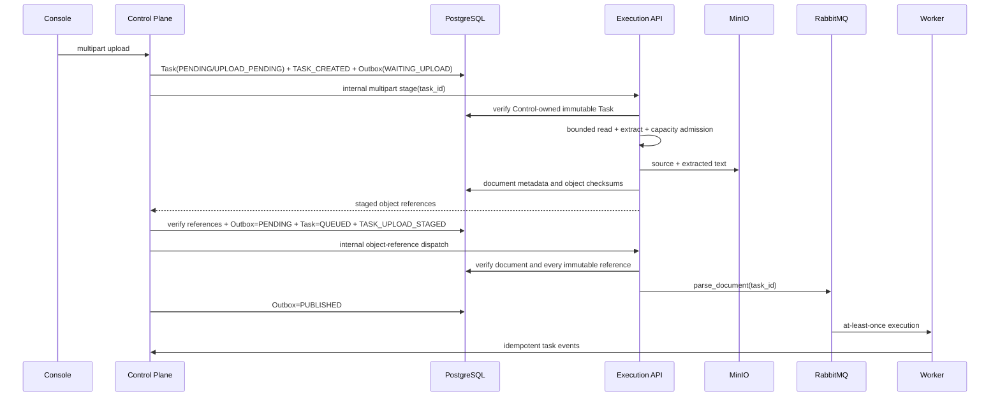

# Control Plane multipart 文件上传权威与两阶段暂存 v1

状态：已实现并完成真实全栈验收
日期：2026-08-04
范围：`DOC_INGEST` multipart 文件上传（Task Authority Phase 2B）

## 1. 目标与边界

文件二进制不能写入 PostgreSQL Outbox，也不能在 Control 事务中直接完成 MinIO 写入。本阶段采用“Control 创建上传意图，Execution 暂存对象，Control 激活派发”的两阶段协议：

- Console 的 multipart 索引命令只提交给 Control；
- Control 是 Task、事件和派发 Outbox 的唯一权威；
- Execution 负责有界读取、解析、容量准入、MinIO 对象和文档副作用；
- Worker 只通过内部事件 API 回写 Control-owned Task；
- 上传中断或激活失败会形成可恢复、可重试的精确清理义务；
- Outbox 只保存对象引用、校验和与参数，不保存文件内容。

> 历史边界已由 Phase 2E 关闭：`UPLOAD_ONLY` 与 `UPLOAD_AND_CLEAN` 现已创建 `DOC_UPLOAD` Control Task，并具备 `COMPLETED` 成功事实与崩溃超时清理。最新契约见 `control-plane-non-index-upload-authority-v1.zh-CN.md`。本节其余内容保留 Phase 2B 索引上传的实施记录。

## 2. 协议流程



## 3. 接口

### 3.1 Control 公开命令

`POST /api/v1/admin/kbs/{kbId}/documents/upload`

- Content-Type：`multipart/form-data`；
- 文件字段：可重复的 `file`；
- 模式：`UPLOAD_ONLY | UPLOAD_AND_CLEAN | UPLOAD_CLEAN_CHUNK_EMBED`；
- 切块方法：`fixed | sentence | paragraph | markdown | delimiter`；
- 支持 `chunk_size`、`chunk_overlap`、`chunk_delimiter`、`auto_summary`；
- 返回逐文件的 `accepted` / `failed` 结果；索引模式返回稳定的 `task_id` 与 `doc_id`。

### 3.2 Execution 内部暂存

`POST /api/v1/internal/kbs/{tenant_id}/{kb_id}/documents/stage`

只接受内部凭据。索引模式必须携带已存在的 Control-owned Task，且 Task 必须为 `PENDING / UPLOAD_PENDING`，租户、KB、文档和任务类型必须完全匹配。暂存成功只返回对象引用，不发布 Celery 任务。

### 3.3 Execution 内部精确清理

`DELETE /api/v1/internal/kbs/{tenant_id}/{kb_id}/documents/{doc_id}/staging?task_id=...`

只清理身份完全匹配、归属 Control、阶段为 `UPLOAD_PENDING | UPLOAD_FAILED | UPLOAD_TIMEOUT` 的暂存文档。删除沿用 PostgreSQL/MinIO/Qdrant 的持久修复账本，不扩大清理范围。

## 4. 状态与恢复

上传意图新增三类 Outbox 生命周期状态：

- `WAITING_UPLOAD`：Task 与 Outbox 已提交，二进制暂存尚未被 Control 确认；
- `CLEANUP_PENDING`：暂存或激活失败，存在必须重试的精确清理义务；
- `CANCELLED`：清理已成功确认，命令不再允许派发。

正常激活后继续使用 `PENDING | IN_FLIGHT | RETRY | PUBLISHED | DEAD_LETTER`。定时恢复器每 60 秒：

1. 把超时的 `WAITING_UPLOAD` Task 收敛为 `FAILED / UPLOAD_TIMEOUT`；
2. 将对应 Outbox 转为 `CLEANUP_PENDING`；
3. 重试 Execution 精确清理；
4. 只有远端确认清理成功后才写成 `CANCELLED`。

多 Control 实例可能重复调用同一个精确清理接口；该操作按不可变身份约束设计为幂等，不会跨文档删除。

## 5. 不变量与安全门禁

- 文件数量、单文件字节数和批次总字节数在 Control 与 Execution 双重限制；
- Execution 使用“上限 + 1”有界读取，超限文件不会继续读入内存；
- `tenant_id`、`kb_id`、`doc_id`、`task_id`、文件名、bucket、object key、SHA-256 和切块参数在激活与派发时重新核对；
- staged object dispatch 不重复持久化对象；
- 合法的 `chunk_overlap=0` 必须在保存、修改、移动和批量重试中保持为 0；
- Task 终态不可逆，事件幂等，进度单调；
- KB 删除通过数据库级联清除 Task、事件和 Outbox，并调用 Execution 完成跨存储物理清理。

## 6. 配置

Control：

```text
spring.servlet.multipart.max-file-size
spring.servlet.multipart.max-request-size
agent-powflow.task-dispatch.max-upload-files
agent-powflow.task-dispatch.max-upload-file-bytes
agent-powflow.task-dispatch.max-upload-batch-bytes
agent-powflow.task-dispatch.upload-intent-timeout
```

Execution 继续使用 `UPLOAD_MAX_FILES_PER_REQUEST`、`UPLOAD_MAX_BATCH_BYTES`、对象存储容量与物理容量准入配置。

## 7. 验收证据

2026-08-04：

- Control：95/95，真实 PostgreSQL、0 跳过，Flyway V1–V12；
- Execution：136/136，真实隔离 PostgreSQL + TLS MinIO、0 跳过，schema V1–V8；
- Console：50/50；Endpoint catalog：267/267、100%；
- 真实 multipart：`Task=SUCCEEDED`、`state_owner=CONTROL`、`Outbox=PUBLISHED`、`Document=INDEXED`；
- 21 条 Control Task 事件中 19 条来自 `source_service=execution-plane`；
- 严格清理：KB、Task、Outbox、事件、文档、Qdrant collection、MinIO 前缀、孤儿 Outbox、隔离测试 schema 均为 0。

可重复验收：

```powershell
powershell.exe -NoProfile -ExecutionPolicy Bypass -File tools/smoke/multipart-task-authority-smoke.ps1
```

## 8. 后续顺序

1. 文档摘要、切块提交、移动、标签和删除已由 Phase 2C 改为 Control 命令/Task/Outbox，见 `control-plane-document-command-authority-v1.zh-CN.md`；
2. ~~为非索引上传模式引入持久文档命令与清理事实；~~ 已由 Phase 2E 完成；
3. 完成兼容期观测后退役 Execution 公共写入口；
4. 按 domain router/service/repository 拆分 Execution 巨型模块，并补跨实例压力与故障演练。
