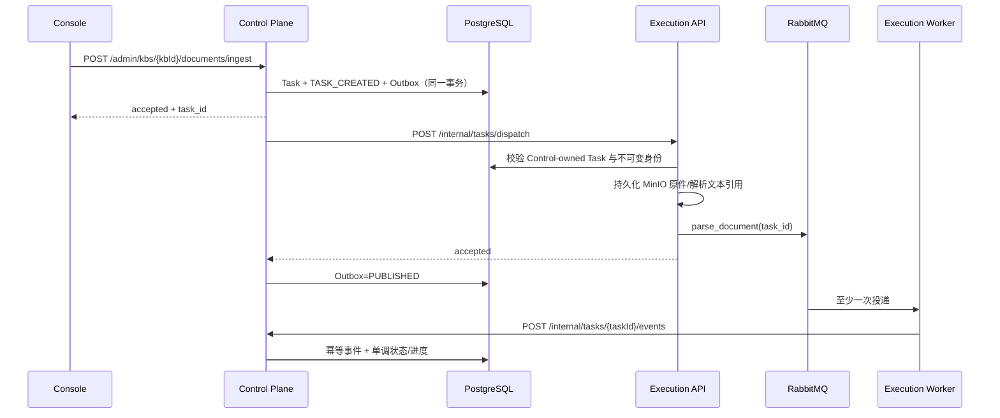

# Control Plane 任务创建、可靠派发与 Worker 回写 v1

状态：已实现并完成真实全栈验收
日期：2026-08-04
范围：文本入库 `DOC_INGEST` 垂直链路（Task Authority Phase 2A）

## 1. 目标与边界

本阶段把文本入库任务的创建、状态和事件权威统一到 Control Plane，同时保留 Execution Plane 对文档对象、解析、分块、向量化和索引副作用的职责。

已纳入本契约：

- Console 文本入库命令只提交给 Control Plane；
- Control 在同一 PostgreSQL 事务中创建 Task、`TASK_CREATED` 事件和派发 Outbox；
- Outbox 以至少一次语义调用 Execution 内部派发接口；
- Worker 通过内部事件接口回写 Control，不直接修改 Control-owned Task；
- 事件以 `tenant_id + event_id` 幂等；
- 派发死信可查询、审计和人工重放；
- 删除 Task 时数据库级联清除对应派发 Outbox。

本契约不包含 multipart；该缺口已在 Phase 2B 以两阶段上传意图关闭，见 `docs/design/control-plane-multipart-upload-authority-v1.zh-CN.md`。其他 Execution-owned 兼容任务的创建入口仍未迁移；旧任务只有在 `state_owner=EXECUTION` 时继续走本地写入路径，不会被回写开关半迁移。

## 2. 权威数据流



## 3. 核心不变量

- `tenant_id`、`kb_id`、`doc_id`、`task_type` 创建后不可变；派发和回写均重新核对。
- 状态使用显式迁移表，终态不可逆；进度单调不减，有总量的终态任务收敛到 100%。
- Celery 重投的 `TASK_ENSURE` 保持当前状态和阶段，不把 RUNNING 或终态回退到 PENDING。
- Worker 以规范化事件内容计算稳定 SHA-256 `event_id`；Control 使用 `(tenant_id, event_key)` 唯一索引去重。
- 回写桥同时检查环境开关和 `state_owner`，只把 Control-owned Task 路由到内部事件 API。

## 4. Outbox 运维契约

状态为 `PENDING | IN_FLIGHT | RETRY | PUBLISHED | DEAD_LETTER`。领取使用 PostgreSQL `FOR UPDATE SKIP LOCKED`，失败采用有上限指数退避；重试耗尽时 Task 进入 `FAILED / DISPATCH_DEAD_LETTER`。

管理员接口：

- `GET /api/v1/admin/task-dispatches[?status=DEAD_LETTER]`
- `POST /api/v1/admin/task-dispatches/{outboxId}/replay`

重放只接受当前仍为 `DEAD_LETTER` 的租户内记录，并原子重置 Outbox 与 Task 到 `PENDING / QUEUED`，追加 `TASK_DISPATCH_REPLAYED` 事件。

## 5. 数据库迁移

- V11：增加 Task 事件幂等键、唯一索引和 `task_dispatch_outbox`；
- V12：清理历史孤儿 Outbox，并增加 `task_dispatch_outbox.task_id → tasks.task_id ON DELETE CASCADE`。

V12 防止知识库/任务清理后遗留不可执行的派发事实。迁移覆盖空 schema、共享非空 schema 和既有 V1 schema 三种真实 PostgreSQL 路径，并由 Hibernate `validate` 校验。

## 6. 运行配置

API 与 Worker 均设置：

```text
TASK_AUTHORITY_CALLBACK_ENABLED=true
CONTROL_PLANE_INTERNAL_URL=http://control-plane:8080
CONTROL_PLANE_INTERNAL_TOKEN=<shared internal credential>
```

## 7. 验收证据

2026-08-04：

- Control Plane：89/89，真实 PostgreSQL、无跳过，Flyway V1–V12；
- Console：49/49；Execution：133/133（真实隔离 PostgreSQL + TLS MinIO、无跳过，Execution schema V1–V8）；
- Endpoint catalog：264/264，100%；
- Control、Execution、Console HTTP：200；
- API 与 Worker 均确认回写开关开启，MinIO TLS 与 CA 挂载有效；
- 最终真实文本入库达到 `Task=SUCCEEDED`、`state_owner=CONTROL`、`Outbox=PUBLISHED`、`Document=INDEXED`；20 个事件中 19 个带有 `source_service=execution-plane`，证明 Worker 经 Control 内部事件 API 回写；
- 严格清理后 `KB=0、Task=0、Outbox=0、Event=0、孤儿 Outbox=0、隔离测试 schema=0`。

可重复验收：

```powershell
powershell.exe -NoProfile -ExecutionPolicy Bypass -File tools/smoke/task-authority-smoke.ps1
```

## 8. 后续工作

multipart 文件上传意图已由 Phase 2B 改为 Control 命令/Outbox。下一阶段应逐类迁移摘要、分块提交、移动、标签和删除等目前仍由 Execution 创建的任务；迁移完成后才能关闭 Execution 公共任务创建兼容入口。
