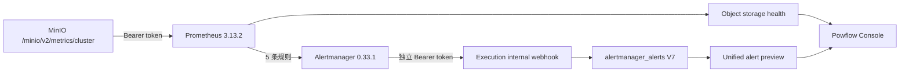

# MinIO 物理容量可观测性与告警闭环 v1

## 目标

对象存储逻辑配额只能回答“租户已承诺多少字节”，不能回答磁盘、节点和驱动是否健康。本方案以 MinIO 官方 Prometheus 指标补齐物理容量，并将告警从瞬时监控状态转为 Execution PostgreSQL 中可审计、可恢复的事实。

## 数据链路



## 官方指标与状态计算

当前读取以下 MinIO cluster 指标：

- `minio_cluster_capacity_usable_free_bytes` / `minio_cluster_capacity_usable_total_bytes`：面向业务的可用容量与比例；
- `minio_cluster_capacity_raw_free_bytes` / `minio_cluster_capacity_raw_total_bytes`：底层原始容量；
- `minio_cluster_drive_online_total` / `minio_cluster_drive_offline_total`：驱动状态；
- `minio_cluster_nodes_online_total` / `minio_cluster_nodes_offline_total`：节点状态；
- Prometheus `up{job="minio-cluster"}`：抓取链路状态。

Execution API 的物理容量快照遵循 fail-closed：已配置 Prometheus 时，查询失败、指标缺失、抓取失败、离线节点或离线驱动均返回 `CRITICAL`；可用比例低于 warning/critical 阈值时分别返回 `WARN`/`CRITICAL`。未配置时显式返回 `UNCONFIGURED`，不伪装成健康。

## 告警规则

`infra/observability/rules/minio-capacity.yml` 固化 5 条规则：指标缺失、驱动离线、节点离线、可用容量低于 20%、可用容量低于 10%。前 3 条为基础设施故障，后 2 条为容量水位。Alertmanager 的 `group_wait=15s`、`group_interval=30s`、`repeat_interval=4h`，并发送恢复通知。

## Secret 与网络边界

`minio-metrics-token-init` 在启动阶段调用 `mc admin prometheus generate`，将令牌写入只被初始化器和 Prometheus 挂载的只读凭据文件；令牌不进入 Prometheus 配置文本和日志。Alertmanager 使用独立的 `ALERTMANAGER_WEBHOOK_TOKEN`，通过只读凭据文件访问 Execution 内部 webhook。Prometheus 与 Alertmanager 端口只绑定 `127.0.0.1`，生产环境仍应由内网、反向代理或运维隧道控制访问。

## 持久化与恢复语义

Execution V7 新增 `alertmanager_alerts`。以 Alertmanager fingerprint 幂等 upsert，保存标签、注解、首次/最后接收时间、开始/结束时间和 `FIRING`/`RESOLVED` 状态。恢复通知更新同一事实并写入 `resolved_at`；已恢复事实默认保留 90 天后清理。统一告警预览合并当前物理容量快照与持久化的 firing 事实，因此短暂抓取抖动后仍有审计依据。

## 启动与验收

```powershell
.\infra\scripts\start-stack.ps1 -Observability
powershell -NoProfile -ExecutionPolicy Bypass -File .\tools\smoke\minio-observability-smoke.ps1
```

验收必须同时满足：MinIO target 唯一且为 `up`、可用容量指标为正、5 条规则已加载、Prometheus 能发现 Alertmanager、合成告警 firing webhook 成功、恢复 webhook 成功、数据库事实最终为 `RESOLVED`。

2026-08-03 实测：双 webhook 冒烟通过；随后加入物理容量写入准入与 bucket 生命周期治理，Execution 真实 PostgreSQL + Compose MinIO 回归 `126/126`，无跳过；Console `30/30` 且生产构建通过；端点目录 `243/243`。

## 当前边界

- 当前是单 MinIO 实例开发栈，不能替代多节点网络分区、磁盘故障和纠删码降级演练；
- 告警已进入 Console 事实层，但外部值班渠道、升级策略、静默/抑制审批仍需按部署组织接入；
- 物理水位用于阻断与运维判断，租户逻辑配额仍是写入准入的独立控制面，两者不能互相替代。
